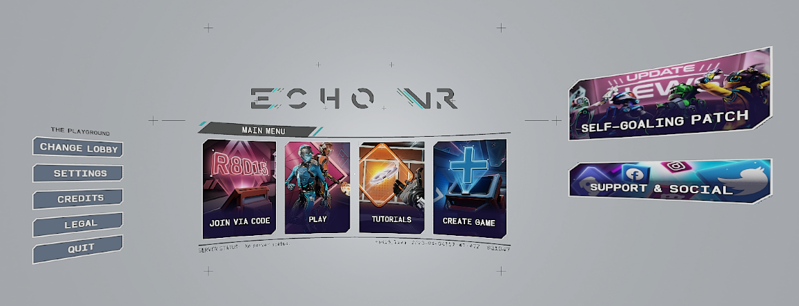
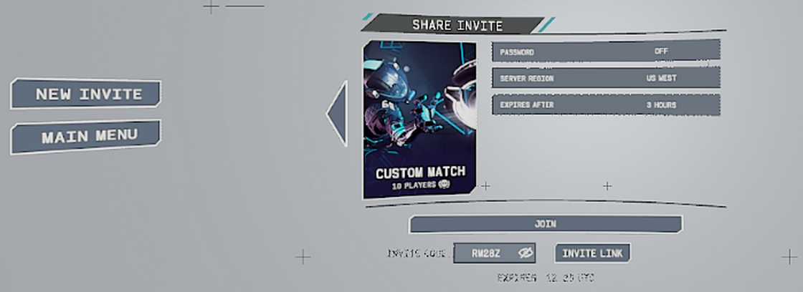
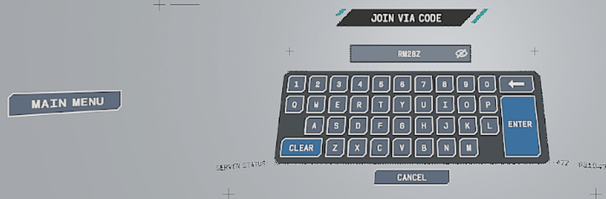
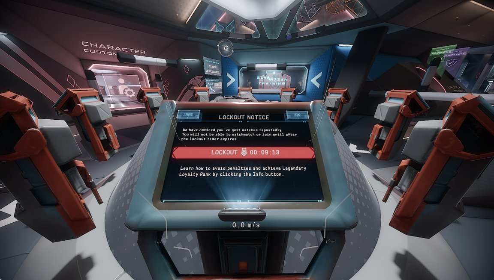

# Install: PC

Research / educational use, LAN only. Tested on PC build `6323983201049540` (2023-05-03); every plugin refuses any
other build. The steps below are re-checked on a clean install before each release ([status.md](status.md)).

`<game>` below is your Echo VR install folder, the one that holds `bin\win10\echovr.exe` (the Oculus library default
is `C:\Program Files\Oculus\Software\Software\ready-at-dawn-echo-arena`).

## 1. Point the client at your services

Fill in `<game>\_local\config.json` with the service addresses of the host you connect to (for the EchoRelay
fork, the keys are in its `docs/headless.md`, "Client config"). rad-links reads the same file: `apiservice_host` is the address it
sends invite requests to.

## 2. Build

From the repository root, in a Visual Studio x64 developer prompt:

```
pip install -r requirements.txt
sdk\pc\build.cmd          :: the winmm.dll proxy
sdk\pc\build_mods.cmd     :: rad-links.dll, evrmod_earlyquit.dll, and the offline broker self-test
```

Both scripts call the VS 2022 **Build Tools** `vcvars64.bat`. With another VS 2022 edition, first
`set VCVARS=<path to its vcvars64.bat>`. A good build ends with `SELFTEST PASS` and `BUILD OK`.

## 3. Install

1. Copy `sdk\pc\build\winmm.dll` next to `echovr.exe` (`<game>\bin\win10\`).
2. Make a `mods\` folder beside it and copy `sdk\pc\build\mods\rad-links.dll` and
   `sdk\pc\build\mods\evrmod_earlyquit.dll` into it. Plugins load alphabetically unless `mods\load_order.txt` lists
   an order.
3. Main-menu cards (optional; the wizard is also reachable without them): generated from your own game files and
   written as a patched copy of the language package. With the game closed, from a prompt started with **Run as
   administrator** (the install is under `C:\Program Files`), `cd` to the repository root, then:

       python mods/menu-cards/menu_cards.py pc build --game "C:/Program Files/Oculus/Software/Software/ready-at-dawn-echo-arena" --out C:/echovr-cards
       python mods/menu-cards/menu_cards.py pc apply --game "C:/Program Files/Oculus/Software/Software/ready-at-dawn-echo-arena" --out C:/echovr-cards

   Use your own `<game>` if it is elsewhere. Keep the `--out` folder for `revert`. Which Python and the errors:
   [mods/menu-cards/README.md](../mods/menu-cards/README.md).
4. Launch the game normally. `<game>\bin\win10\mods\evrmod.log` lists the build check and each plugin loaded;
   rad-links writes `<game>\bin\win10\_local\radlinks.log` and early quit `<game>\bin\win10\_local\earlyquit.log`.

An unsigned side-loaded `winmm.dll` can be scored by Microsoft Defender. Check its verdict on your machine.

## What it looks like

The main menu with the two cards (JOIN VIA CODE, CREATE GAME) beside the stock PLAY and TUTORIALS:



CREATE GAME → ECHO ARENA → CUSTOM MATCH → CREATE INVITE CODE & LINK shows the code your host issued; JOIN VIA CODE
takes it on another client:




With early quit on, a player your host has locked out sees the game's own notice:



## 4. Uninstall

Delete `winmm.dll` and the `mods\` folder from `<game>\bin\win10\`. If you added the cards, put the stock language
package back with the same folder you used for `build` / `apply` (keep it until you revert):

    python mods/menu-cards/menu_cards.py pc revert --game "C:/Program Files/Oculus/Software/Software/ready-at-dawn-echo-arena" --out C:/echovr-cards

The executable on disk is never modified. The plugin logs in `<game>\bin\win10\_local\` can be deleted too.
