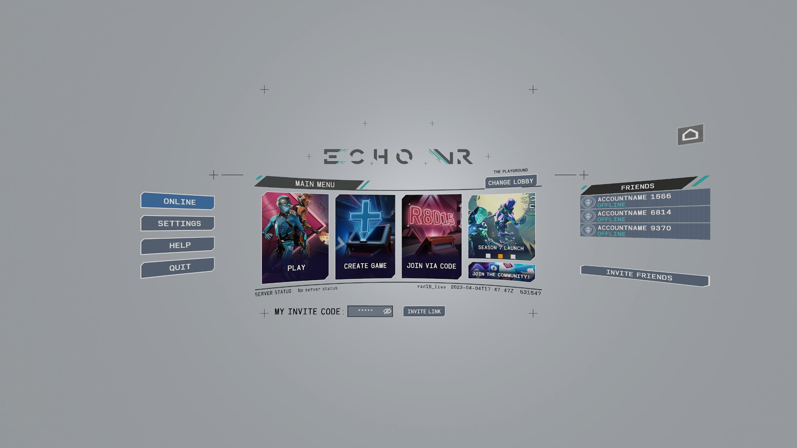

# Install: PC

Research / educational use, LAN only. Tested on PC build `6323983201049540` (2023-05-03); every plugin refuses any
other build. The steps below are re-checked on a clean install before each release ([status.md](status.md)).

`<game>` below is your Echo VR install folder, the one that holds `bin\win10\echovr.exe` (the Oculus library default
is `C:\Program Files\Oculus\Software\Software\ready-at-dawn-echo-arena`).

## 1. Point the client at your services

Fill in `<game>\_local\config.json` (note: `_local` directly under `<game>`, not under `bin\win10`) with the service addresses of the host you connect to (for the EchoRelay
fork, the keys are in its `docs/headless.md`, "Client config"). rad-links reads the same file: `apiservice_host` is the address it
sends invite requests to.

Optional: add `"invite_link_base": "http://myhost.lan:777"` to the same file to change the address the INVITE LINK
page shows (see "Invite links" in the rad-links README). Without it the page shows the link the host sends, which is
built from the host's `--link-base` (default: the host's LAN address, printed in the host's start-up log; set `--link-base`
if this PC cannot reach it). Use an address this PC can reach.

## 2. Build

From the repository root, in a Visual Studio x64 developer prompt:

```
pip install -r requirements.txt
sdk\pc\build.cmd          :: the winmm.dll proxy
sdk\pc\build_mods.cmd     :: rad-links.dll, rad-menu.dll, evrmod_earlyquit.dll, and the offline broker self-test
```

Both scripts call the VS 2022 **Build Tools** `vcvars64.bat`. With another VS 2022 edition, first
`set VCVARS=<path to its vcvars64.bat>`. A good build ends with `SELFTEST PASS` and `BUILD OK`.

## 3. Install

The sub-steps are labelled 3a to 3e. Commands use `python`; on Linux or WSL write `python3`. Two `_local` folders are involved: `<game>\_local\` holds `config.json` (step 1), and `<game>\bin\win10\_local\` holds `radmenu.ini` and all the plugin logs.

3a. Copy `sdk\pc\build\winmm.dll` next to `echovr.exe` (`<game>\bin\win10\`).
3b. Make a `mods\` folder beside it and copy `sdk\pc\build\mods\rad-links.dll` and
   `sdk\pc\build\mods\evrmod_earlyquit.dll` into it, and `rad-menu.dll` too if you install Main Menu A (3d).
   Plugins load alphabetically unless `mods\load_order.txt` lists an order. rad-menu reads its options from
   `<game>\bin\win10\_local\radmenu.ini` if you create one (all optional; see [mods/rad-menu/README.md](../mods/rad-menu/README.md)).
3c. Main-menu cards (optional, and not together with Main Menu A in 3d; the wizard is also reachable without them): generated from your own game files and
   written as a patched copy of the language package. With the game closed, from a prompt started with **Run as
   administrator** (the install is under `C:\Program Files`), `cd` to the repository root, then:

       python mods/menu-cards/menu_cards.py pc build --game "C:/Program Files/Oculus/Software/Software/ready-at-dawn-echo-arena" --out C:/echovr-cards
       python mods/menu-cards/menu_cards.py pc apply --game "C:/Program Files/Oculus/Software/Software/ready-at-dawn-echo-arena" --out C:/echovr-cards

   Use your own `<game>` if it is elsewhere. Keep the `--out` folder for `revert`. Which Python and the errors:
   [mods/menu-cards/README.md](../mods/menu-cards/README.md).
3d. Main Menu A (optional; the redesigned menu with the friends panel, season card, Report Player and the rest).
   Both steps edit the language package, so if you applied the cards, revert them first. From the repository root,
   with Python and `pip install -r requirements.txt` (`check` and `pc` also need `bash`: Linux, WSL or Git Bash):

       python mods/main-menu-a/build_main_menu_a.py check      --game "<game>"
       python mods/main-menu-a/build_main_menu_a.py pc         --game "<game>" --out C:/echovr-menu-tree
       python mods/main-menu-a/build_main_menu_a.py pc-package --game "<game>" --pc-tree C:/echovr-menu-tree --out C:/echovr-menu-pkg

   `check` writes nothing and says whether your language package is stock. `pc` builds the verified resource tree
   (58 files) from your install and takes a few minutes; `pc-package` appends it as rows to a copy of your own language
   package and reads every new row back. Then, with the game closed and from a prompt started with **Run as
   administrator**:

       python mods/main-menu-a/build_main_menu_a.py pc-apply   --game "<game>" --out C:/echovr-menu-pkg

   It ends with `install language package: stock -> menu`. No loader or extra flag is needed to see the new menu; add
   `rad-menu.dll` and `rad-links.dll` (3b) for the live parts. Keep `C:/echovr-menu-pkg`: it holds your stock copy.
   Details and errors: [mods/main-menu-a/README.md](../mods/main-menu-a/README.md).
3e. Launch the game normally. `<game>\bin\win10\mods\evrmod.log` lists the build check and each plugin loaded;
   rad-links writes `<game>\bin\win10\_local\radlinks.log`, rad-menu `<game>\bin\win10\_local\radmenu.log` and early
   quit `<game>\bin\win10\_local\earlyquit.log`.

An unsigned side-loaded `winmm.dll` can be scored by Microsoft Defender. Check its verdict on your machine.

## What it looks like

Pictures are being retaken at full resolution (PC 1920x1080, uncropped) and added to [menu-tour.md](menu-tour.md).
Planned for this page:


<!-- shot pending: pc-share-invite-code.png (CREATE INVITE CODE & LINK, the code and expiry) -->
<!-- shot pending: pc-join-via-code.png (the JOIN VIA CODE keypad) -->
<!-- shot pending: pc-invite-link-card.png (INVITE LINK page, link from the host) -->
<!-- shot pending: pc-lockout-notice.png (the early-quit lockout notice) -->

CREATE GAME → ECHO ARENA → CUSTOM MATCH → CREATE INVITE CODE & LINK shows the code your host issued; JOIN VIA CODE
takes it on another client. With early quit on, a player your host has locked out sees the game's own notice, and
with rad-menu the PLAY / CREATE GAME / JOIN VIA CODE cards show the lockout countdown.

## Launch options

The game's own command line is read by `echovr.exe`; a few arguments below are **not** in the stock executable and
exist only when the EchoRelay patch DLL is installed. Start the game with them from a shortcut or a command prompt
(`bin\win10\echovr.exe <options>`).

**The patch DLL.** `-windowed`, `-server`, `-offline` and `-timestep` come from the fork's `EchoRelay.Patch`, not from
the game. Build it as the fork's `docs/headless.md`, "Build", describes (no binaries are published), copy it as
`dbgcore.dll` next to `echovr.exe` (`<game>\bin\win10\`), and keep the game on build `6323983201049540`; the patch
warns when the executable is another build. Without `dbgcore.dll` the game does not know `-windowed`: it is not a
registered option, so the game rejects it as "not a valid command line argument" and the window mode does not start
(whether it then exits or only logs the message was not checked). The patch also lets `-noovr` run on its own; the
stock executable wants `-spectatorstream` with it.

| option | what it does | provided by |
|---|---|---|
| `-noovr` | Starts with the built-in demo account instead of the Oculus login: no Oculus app or login (it does not remove the headset: that is `-windowed`). The client then honours `-gametype`, `-level` and `-lobbyid` | game (alone only with the patch DLL) |
| `-windowed` | Runs in a desktop window with no headset. Add `-noovr` for the demo account | patch DLL |
| `-gametype <type>` | Game type to request, for example `social_2.0` or `echo_arena_private` | game |
| `-region <code>` | Region code sent with the request, for example `usw`; it must be one your host accepts | game |
| `-level <name>` | Level to load, for example `mpl_arena_a`. With a private `-gametype` your host starts it on an idle game server; with no `-gametype` the client loads it locally | game |
| `-lobbyid <id>` | Joins the session behind an invite-link id or lobby id, skipping the menu | game |
| `-lobbyteam <n>` | Team to join as, together with `-lobbyid` | game (only `0` was tried) |
| `-httpport <port>` | Port of the game's own local HTTP API (default 6721 on a client, 6719 on a game server) | game |
| `-server` | Runs a dedicated game server that registers with your host | patch DLL |
| `-headless` | Console process with no graphics or audio (a game server); use with `-server` | game, fixed by the patch DLL |
| `-timestep <n>` | Server tick rate in ticks per second under `-headless`; default 120, `0` = unthrottled. Lower it if the server cannot keep up | patch DLL |
| `-numtaskthreads <n>` | Number of worker threads (a server with `2` ran two) | game |
| `-serverregion <code>` | Region a game server registers with | game |

Two routes start the client. With `-noovr` you need no Oculus account and the arguments above take effect. Without it
the game uses the Oculus login, needs the Oculus app running and the install in the Oculus library, and ignores
`-gametype`, `-level` and `-lobbyid`: you reach a match from the menu. Game servers need the service config
(`config.json`) from step 1 as well; see [server.md](server.md).

A client example for a LAN host: `echovr.exe -noovr -windowed -gametype echo_arena_private -region usw -lobbyid <id>`.

## 4. Uninstall

Delete `winmm.dll` and the `mods\` folder from `<game>\bin\win10\`. If you added Main Menu A, close the game and put
the stock language package back from an administrator prompt (`pc-revert` checks your stock copy before it writes):

    python mods/main-menu-a/build_main_menu_a.py pc-revert --game "<game>" --out C:/echovr-menu-pkg

If you added the cards instead, put the stock language
package back with the same folder you used for `build` / `apply` (keep it until you revert):

    python mods/menu-cards/menu_cards.py pc revert --game "C:/Program Files/Oculus/Software/Software/ready-at-dawn-echo-arena" --out C:/echovr-cards

The executable on disk is never modified. The plugin logs, and `radmenu.ini` if you made one, are in `<game>\bin\win10\_local\` and can be deleted too. `<game>\_local\config.json` is yours: delete it only if you want the client back on the stock hosts, which no longer answer.
