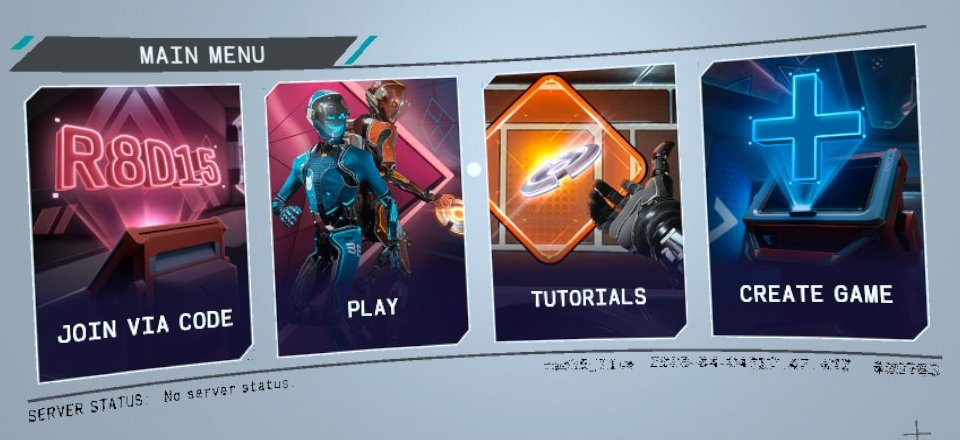
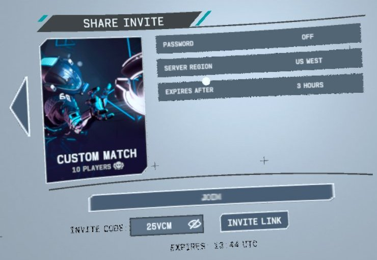
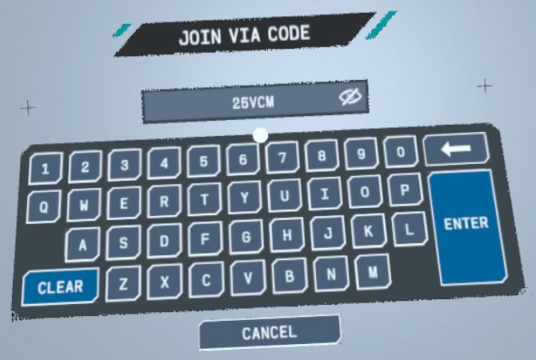
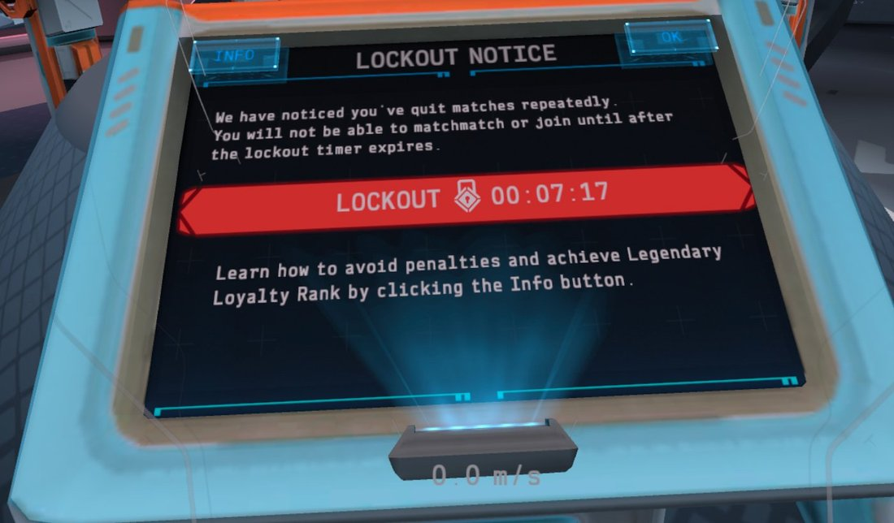

# Install: Quest

Research / educational use, LAN only. Tested on a Quest 3 (Horizon OS 207, Android 14) with Echo VR build
`6528386917200980` (version code 4987566). A re-signed APK has no Oculus social features (friends, party, rooms,
store invites). The steps below are re-checked on a clean install before each release ([status.md](status.md)).

## What you need

- Your own copy of that build (this kit does not obtain or back up game files):
  - the stock APK, sha256 `21c7dc914dba2fa44f8daf019aedffa4a17e14186283ef05805217fc80d30eaf` (the builder refuses
    any other; a copy that kept updating after 2023-05 is the farewell build and will not work);
  - the game data unpacked as a `manifests/` and a `packages/` folder, the layout community installs use. The game
    reads them from `/sdcard/readyatdawn/_data/5932408047/rad15/android/`; no OBB is needed.
- The headset in developer mode, with USB debugging allowed for your PC (`adb devices` shows `device`).
- A host on the same LAN as the headset (see [server.md](server.md)). The headset itself must reach it.
- Android NDK r26d and a JDK (`keytool`) on the build machine.

## 1. Build the APK

From the repository root (Linux or WSL). The two build scripts look for the NDK in `~/toolchains/android-ndk-r26d`;
set `NDK=` to use another location:

    pip install -r requirements.txt
    NDK=/path/to/android-ndk-r26d bash mods/rad-links/build_quest.sh       # -> mods/rad-links/build/libradlinks.so
    NDK=/path/to/android-ndk-r26d bash sdk/quest/loader/build_quest.sh     # -> sdk/quest/loader/build/libevrmod.so
    python3 sdk/quest/quest_apk_build_release.py --apk STOCK.apk --dry-run              # check every step, write nothing
    python3 sdk/quest/quest_apk_build_release.py --apk STOCK.apk --out echovr-mod.apk --keystore my.p12

The builder takes the two libraries from those paths by default. Its steps include early quit, the plugin loader,
the `/sdcard` service config, and the platform login-prerequisite patch that lets the game log in to your own host
(`--help` lists all nine). It checks the stock hash of every library it patches, applies its steps in order, and signs with `my.p12`
(v1 signature; created with `keytool` if it does not exist; password `android` unless you pass `--storepass`).
Keep that key: an update signed with the same key installs over the old one and keeps the game data; an update
signed with another key needs an uninstall.

## 2. Install

Any copy signed with a different key (the store's, or a community build's) must be uninstalled first: Android will
not install over it. The data folder lives outside the app; push it once if it is not on the headset yet (run the
last line from the folder that holds `manifests/` and `packages/`).

    adb shell am force-stop com.readyatdawn.r15
    adb uninstall com.readyatdawn.r15
    adb install -g echovr-mod.apk
    adb push manifests packages /sdcard/readyatdawn/_data/5932408047/rad15/android/

`-g` grants the three permissions the game asks for at start (storage read, storage write, microphone). That is all
it needs: the game targets Android 10 and uses legacy storage, so it reads its service config and the plugin kill
switch from `/sdcard` and writes its logs there with these grants alone. Without `-g`, the first launch stops at
Android's permission prompt and the client does not log in until the prompt is accepted in the headset. To update
later with the same key, use `adb install -r -g echovr-mod.apk` (no uninstall; the game data is kept).

## 3. Point the client at your host

Write your host's service config (the same keys as the PC `config.json`: `apiservice_host`, `configservice_host`,
`loginservice_host`, `matchingservice_host`, `serverdb_host`, `transactionservice_host`, and `publisher_lock` =
`rad15_live`) and push it:

    adb push config.json /sdcard/readyatdawn/_local/config.json

Use addresses the headset can reach on your LAN. If the file is absent the client uses the stock hosts, which no
longer answer, so it never logs in. If the file is not valid JSON the client stays offline (no crash, no fallback);
fix or delete it. You can change the file at any time; it is read when the game starts.

## 4. Launch

Start Echo VR from Library > Unknown Sources, or:

    adb shell am start -n com.readyatdawn.r15/com.oculus.gles3jni.MainActivity

Stop it with `adb shell am force-stop com.readyatdawn.r15` (do this before relaunching after a config change).
Hold your controllers: the headset asks for them at launch. On the first start the game shows its EULA and content
panels, which come from your host. If a permission prompt was left open and launches
are refused ("an OS dialog is currently showing"), close it with
`adb shell am force-stop com.android.permissioncontroller`.

## 5. Main-menu cards (optional)

The cards are added through a patched copy of the language package in the game's unpacked data folder
(`/sdcard/readyatdawn/_data/5932408047/rad15/android/`), so the data folder must be on the headset first (step 2).
With Echo VR closed on the headset:

    python3 mods/menu-cards/menu_cards.py quest pull  --work WORK
    python3 mods/menu-cards/menu_cards.py quest build --work WORK --out DIR
    python3 mods/menu-cards/menu_cards.py quest push  --out DIR

Keep `DIR`: it holds the stock copy that `revert` puts back. Details and errors:
[mods/menu-cards/README.md](../mods/menu-cards/README.md). The invite wizard itself does not need the cards.

## What it looks like

The main menu with the two cards, the code CREATE GAME shows after CREATE INVITE CODE & LINK, the same code typed
into JOIN VIA CODE, and the early-quit lockout notice in the lobby (off-head captures, cropped):

## Logs and recovery

    adb logcat -s evrmod:V radlinks:V RAD:I

Start it before you launch the game: the loader's lines come in the first second.

`evrmod` is the plugin loader (which plugins it loaded), `radlinks` is rad-links, `RAD` is the game. The game's own
log files are in `/sdcard/r14logs/`. If a plugin keeps the game from starting:

    adb shell touch /sdcard/readyatdawn/_local/evrmod.disable    # no plugin is loaded
    adb shell rm /sdcard/readyatdawn/_local/evrmod.disable       # plugins back on

The kill switch works even if the storage permissions were not granted.

## Uninstall

If you added the cards, revert them first. They live in the data folder, outside the APK, so uninstalling does not
remove them. `DIR` is the folder you used for `build` / `push`:

    python3 mods/menu-cards/menu_cards.py quest revert --out DIR

Then:

    adb uninstall com.readyatdawn.r15
    adb shell rm -f /sdcard/readyatdawn/_local/config.json /sdcard/readyatdawn/_local/evrmod.disable

Then reinstall whichever APK you used before.
