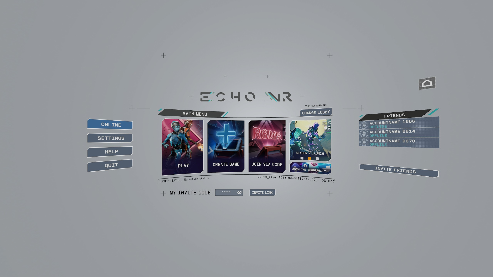
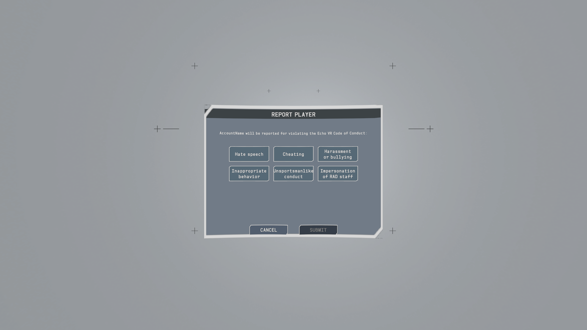
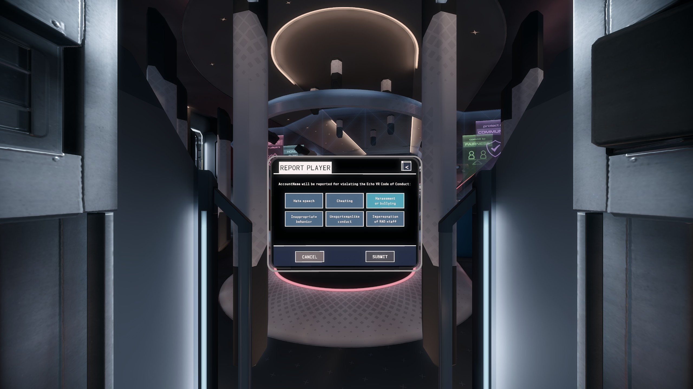
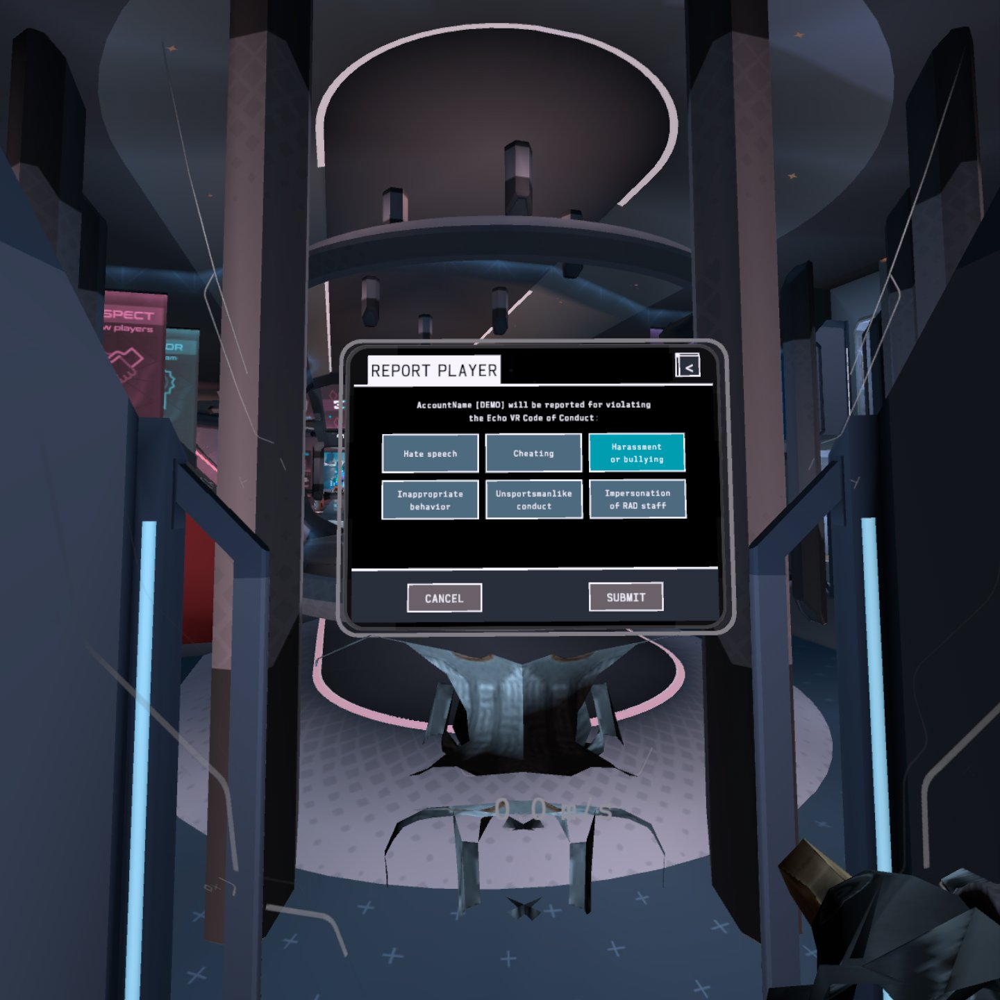
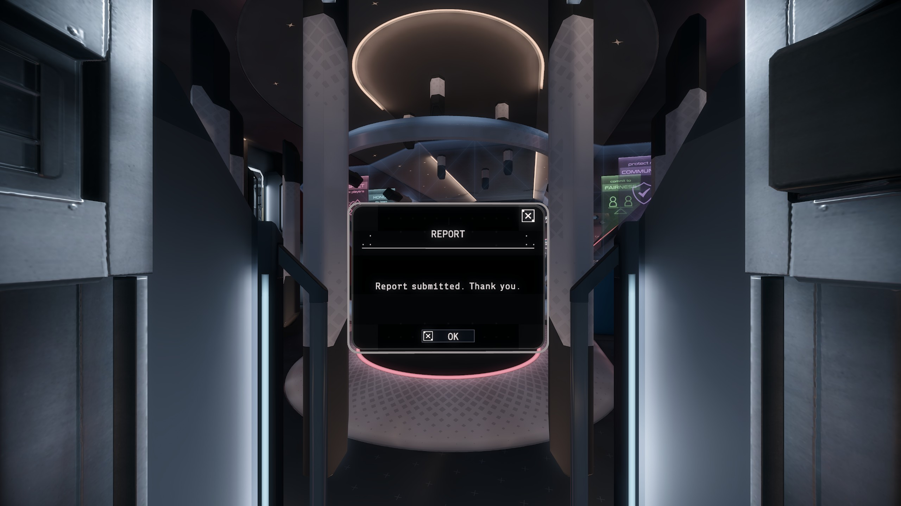
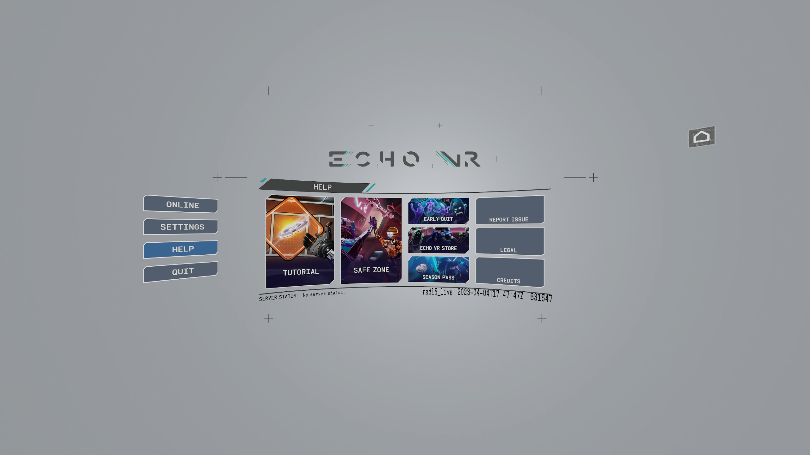
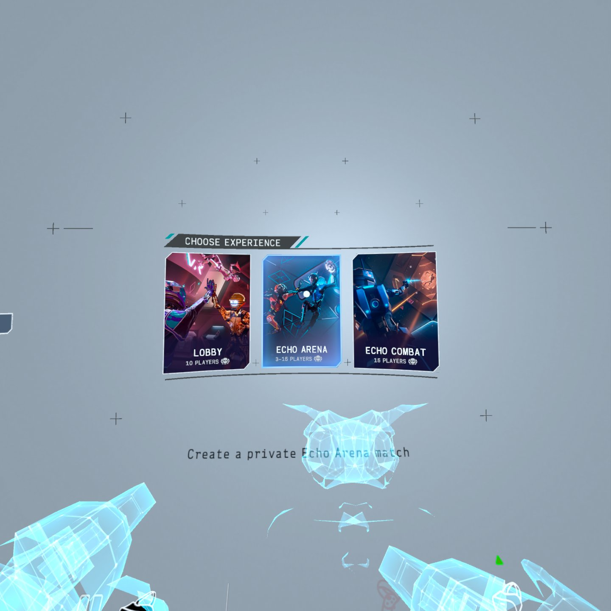

# Menu tour

A page-by-page look at what 0.2.0 adds, with the same layout for PC and Quest. Research / educational use, LAN only.
Pictures are full-frame captures: PC `6323983201049540` at 1920x1080, Quest `6528386917200980` at 1440x1440 (one eye,
uncropped), with neutral test accounts, expired codes and a documentation address in every link. Each picture below is
still to be taken (`<!-- shot pending -->`); the text says what it will show. What has been checked, and how, is in
[status.md](status.md); this page makes no claim beyond it.

Menu design by DC Coffey (case study: https://dccoffey.com/work/echo-vr-02). See [design-lineage/](design-lineage/README.md).

## Main Menu A: the home page

The rail (ONLINE / SETTINGS / HELP / QUIT), the PLAY / CREATE GAME / JOIN VIA CODE cards, the news tile (with the season
card) and the FRIENDS column. Built by `mods/main-menu-a`, made live by `mods/rad-menu`. A stock menu for comparison
has only PLAY and TUTORIALS and no rail.

Main Menu A home on PC (full 2560x1440 frame).

<!-- shot pending: quest-main-menu-a.jpg -->
<!-- shot pending: pc-main-menu-stock.png (control: the stock home, for comparison) -->
<!-- shot pending: quest-main-menu-stock.jpg (control) -->

## Create, share and join

CREATE GAME opens the wizard: the experience (ECHO ARENA / ECHO COMBAT / LOBBY), the match settings, then CREATE INVITE
CODE & LINK, which shows the code and when it expires (3 hours). JOIN VIA CODE takes it. The INVITE LINK page shows
`<link_base>/deeplinks/launch?code=CODE`; the base is the host's `--link-base` (default: its LAN address) unless the
client's `config.json` sets `invite_link_base`. The page's note says to open the link to see the code, or to enter it in
JOIN VIA CODE. Opening the link in a browser on the LAN shows the host's landing page for that invite.

<!-- shot pending: pc-create-wizard-experience.png, quest-create-wizard-experience.jpg -->
<!-- shot pending: pc-create-wizard-settings.png, quest-create-wizard-settings.jpg -->
<!-- shot pending: pc-share-invite-code.png, quest-share-invite-code.jpg -->
<!-- shot pending: pc-join-via-code.png, quest-join-via-code.jpg -->
<!-- shot pending: pc-invite-link-card.png, quest-invite-link-card.jpg (link from the host, documentation address) -->
<!-- shot pending: pc-invite-on-demand.png, quest-invite-on-demand.jpg (the invite row on the home page) -->

## Friends, season card, news

The FRIENDS column shows the host's friends list (`--friends true`) with a press that joins a joinable friend. The news
tile cycles three slides with pager dots; the season slide opens the season popup, and so does the HELP page's SEASON
PASS tile.

<!-- shot pending: pc-friends-panel.png, quest-friends-panel.jpg (two neutral test accounts) -->
<!-- shot pending: pc-season-card.png, quest-season-card.jpg -->
<!-- shot pending: pc-news-carousel-0.png, pc-news-carousel-1.png, pc-news-carousel-2.png (and quest-) -->
<!-- shot pending: pc-news-popup-season.png, quest-news-popup-season.jpg -->

## The pause menu and Report Player

The pause menu is a grid: RESUME, the toggles, REPORT, CREATE GAME and JOIN VIA CODE. REPORT lists the other human
players (AI bots are left out), then six reasons (plus an optional Mute & Ghost box with `report_mute_ghost=1`), then SUBMITTED. The same flow starts from the
five-tile social card (REPORT is the fifth tile). On the tablet, the stock LOBBY list (it scrolls the way the game
always did) opens the five-tile card for a player; its REPORT opens the REPORT PLAYER panel on the tablet (reasons, optional Mute & Ghost, CANCEL / SUBMIT; `report_tablet_reasons`). On that panel the top-right corner shows "<" (back) where the LOBBY list shows the X (close the tablet): "<" and CANCEL go back one step, to the LOBBY list with the player's card open; the pause
menu's reasons page is the automatic fallback. The pause list scrolls (five rows and a peek row). There are no "more players" rows.

<!-- shot pending: pc-pause-grid.png, quest-pause-grid.jpg -->

The pause menu's reasons page on PC, before a reason is picked (SUBMIT is greyed out).

<!-- shot pending: pc-pause-report-list.png, pc-pause-report-submitted.png (and quest-) -->
<!-- shot pending: pc-social-card-report.png, quest-social-card-report.jpg (five tiles) -->
<!-- shot pending: pc-tablet-report-list.png, pc-tablet-report-reasons.png, pc-tablet-report-result.png (and quest-) -->

The REPORT PLAYER panel on the PC tablet, one reason picked.

The same panel on Quest (a hand is visible at the bottom right, outside the panel).

The confirmation shown on the PC tablet after SUBMIT.

## Quit warning, lockout, first-time-user lock

On the pause quit confirm in a public, non-social lobby the warning line is filled in. While the host's early-quit
lockout is live, PLAY / CREATE GAME / JOIN VIA CODE show a countdown and a press opens the lockout notice (and its two
INFO pages). A new player's CREATE GAME / JOIN VIA CODE are dimmed until the tutorial is done.

<!-- shot pending: pc-pause-quit-warning.png, quest-pause-quit-warning.jpg (public arena only) -->
<!-- shot pending: pc-lockout-card-lock.png, quest-lockout-card-lock.jpg -->
<!-- shot pending: pc-lockout-notice.png, quest-lockout-notice.jpg -->
<!-- shot pending: pc-early-quit-info-1.png, pc-early-quit-info-2.png (and quest-) -->
<!-- shot pending: pc-ftue-dim.png, quest-ftue-dim.jpg (ini ftue=force) -->

## HELP page

Eight tiles (among them season pass, safe zone and early quit). On Quest the early-quit, store, report issue, legal and
credits tiles were pressed by event and open their pages; the tutorial tile loads the tutorial (all eight tiles pressed by event).

The HELP page on PC, with the REPORT ISSUE tile.

<!-- shot pending: quest-help-page.jpg -->

## ECHO COMBAT card on Quest

The Quest builder unlocks the card by default; `--no-combat-unlock` leaves it locked. A combat match still does not
start on Quest (no combat level in the build).

CHOOSE EXPERIENCE on Quest with the ECHO COMBAT card unlocked (hands visible at the bottom).

<!-- shot pending: quest-combat-card-locked.jpg -->

## Host admin page

The fork's `/admin` lists invites with their links and reports filtered by player id and reason
([server.md](server.md)). Browser window, 1920x1080, fake player ids, no token in the address.

<!-- shot pending: host-admin-invites.png, host-admin-reports.png -->
